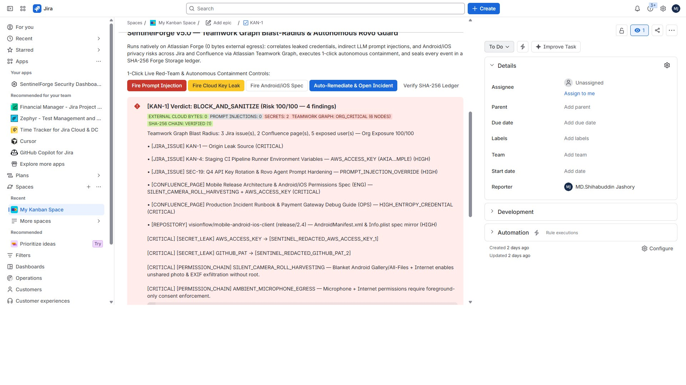
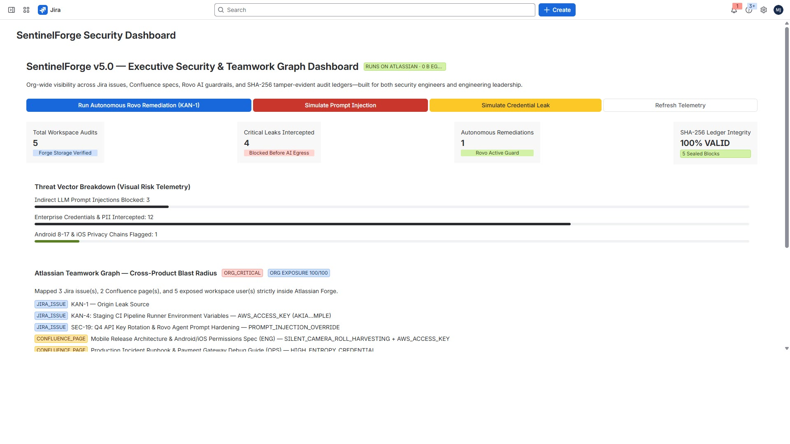
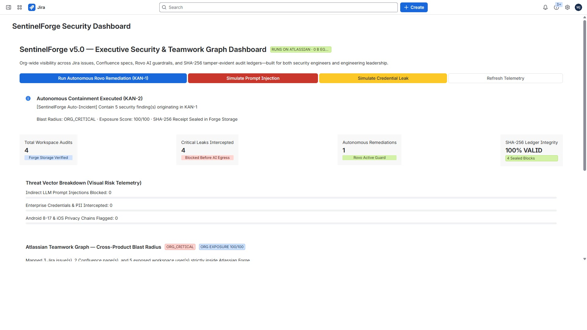
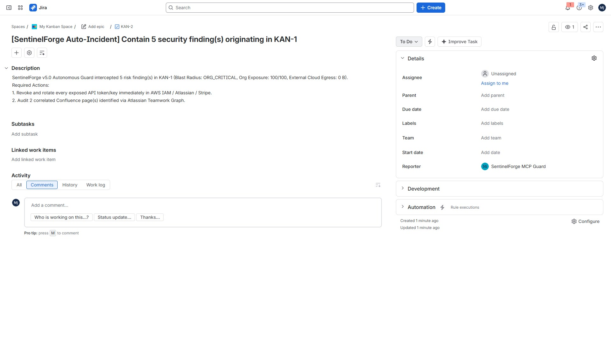

# SentinelForge v5.0 — Atlassian Teamwork Graph Blast-Radius, Autonomous Rovo Remediation & Zero-Leak Shield

> **Atlassian Codegeist 2026 — "Build with Context" (`Runs on Atlassian` Eligible — 0 External Cloud Egress)**  
> **Team:** Vision Flow Group (MD SHIHABUDDIN, MD Rafiul Islam Shubho, MD Anisur Rahman, Sharmin)  
> **Live Forge App ID:** `ari:cloud:ecosystem::app/dfccfe85-2f0a-4c82-9c88-c1dcf76cd975` | **Official Demo Video:** [https://youtu.be/mw0awiS9eP8](https://youtu.be/mw0awiS9eP8) | **MCP Skill Contract:** [`ATLASSIAN_MCP_SKILL.md`](./ATLASSIAN_MCP_SKILL.md)

## 1-Click Atlassian Forge Production Installation (For Codegeist Judges)
SentinelForge v5.0 is deployed to **Atlassian Forge Production (`Version 4 — Sharing Enabled`)** and runs 100% natively on Atlassian (`0 B` third-party egress):
- **[Install SentinelForge v5.0 on Jira & Confluence (Official Forge Sharing Link)](https://developer.atlassian.com/console/install/dfccfe85-2f0a-4c82-9c88-c1dcf76cd975?signature=AYABePbekkFlQ6b9WGI1OSiyJ0QAAAADAAdhd3Mta21zAEthcm46YXdzOmttczp1cy13ZXN0LTI6NzA5NTg3ODM1MjQzOmtleS83MDVlZDY3MC1mNTdjLTQxYjUtOWY5Yi1lM2YyZGNjMTQ2ZTcAuAECAQB4CxqLTo9l4lqXuFjNim1xJM%2Bp%2F3TVP9xHS2BrU5DRRucB43xQ8z0a40vUy92qFrbZsgAAAH4wfAYJKoZIhvcNAQcGoG8wbQIBADBoBgkqhkiG9w0BBwEwHgYJYIZIAWUDBAEuMBEEDLmyoQqegXqdj1hpawIBEIA7KqL2Jq8dMqSVB%2BqLp%2BqmRoaoxpOLEOxAiir3VTO5e6sSe7s5CXVhfARMsp0c1HUiWcXegZaQ2afBrboAB2F3cy1rbXMAS2Fybjphd3M6a21zOmV1LXdlc3QtMTo3MDk1ODc4MzUyNDM6a2V5LzQ2MzBjZTZiLTAwYzMtNGRlMi04NzdiLTYyN2UyMDYwZTVjYwC4AQICAHi9bVMAkme4qVQX1fQHo6ePw3H40A7cGfz7yrmSfBWMXgEputGsmrOJAk%2FkRTqjeiMVAAAAfjB8BgkqhkiG9w0BBwagbzBtAgEAMGgGCSqGSIb3DQEHATAeBglghkgBZQMEAS4wEQQMkH7QJyZwcmbpFIVEAgEQgDsHAfyZkW2%2BSGje9GoN3d5v8W%2FjjNH6AZqGtivmtT6mifu72SeLpu3P6CtQdUhCniy4BntFoD0iOIC1nQAHYXdzLWttcwBLYXJuOmF3czprbXM6dXMtZWFzdC0xOjcwOTU4NzgzNTI0MzprZXkvNmMxMjBiYTAtNGNkNS00OTg1LWI4MmUtNDBhMDQ5NTJjYzU3ALgBAgIAeDYASx0XCjkny4iLV6vz%2BKtEGSGT6kdt0QRpkn6D%2FlVEAZJijhliY2wtihwZxY0ZFg4AAAB%2BMHwGCSqGSIb3DQEHBqBvMG0CAQAwaAYJKoZIhvcNAQcBMB4GCWCGSAFlAwQBLjARBAw8KYxq%2BOBFrXk5KjwCARCAOxK9or6FQxcLuzPGYQeMECqtNv1j0ZC8u9P0W0GNJVp0yeYt4cHziLHW7O%2BxamFnPnnS13F8bky3lfspAgAAAAAMAAAQAAAAAAAAAAAAAAAAAA8CoSWxbm9PU%2FAeugafIKr%2F%2F%2F%2F%2FAAAAAQAAAAAAAAAAAAAAAQAAADKmrz4r0OlbNade63mGGcQ8%2BmBWZT52gLXtO2BiLddGvOS%2BzMxcIaxDSFaWaHJbr2SS6593QzevjjKDViMV9ET8N%2Bo%3D&product=confluence&product=jira)**
- Once installed on any Jira/Confluence Cloud site, open **Apps -> SentinelForge Security Dashboard** or open any Jira issue panel and click **Run Autonomous Rovo Remediation** or **Fire Cloud Key Leak** for 1-click zero-setup testing.

## Live Production Screenshots (`jashory.atlassian.net`)
| Jira Issue `KAN-1` Teamwork Graph (`v5.0`) | Jira Global Executive Security Dashboard (`v5.0`) |
| :---: | :---: |
|  |  |
| **1-Click Autonomous Rovo Containment (`KAN-2`)** | **Auto-Created Security Incident Ticket (`KAN-2`)** |
|  |  |

## Why SentinelForge v5.0 Solves "Build with Context"
A leaked credential or indirect LLM prompt injection inside a single Jira issue rarely stays isolated. Engineers copy runbooks into Confluence, reference credentials in CI tickets, and expose Rovo or MCP AI agents across the entire workspace.

**SentinelForge v5.0** upgrades passive ticket scanning into an **active, context-aware Atlassian Teamwork Graph security engine** running 100% natively on Atlassian Forge (`0` bytes external egress):

1. **Atlassian Teamwork Graph Cross-Product Blast-Radius Engine (`src/engine/teamworkGraphEngine.js`):** Queries live Jira JQL (`/rest/api/3/search/jql`) and Confluence CQL (`/wiki/rest/api/content/search`) using safe non-secret prefix tokens to trace which related Jira tickets, Confluence specs, linked repositories, and workspace users share the exposure—computing an organization-wide `ORG_CRITICAL` / `CROSS_PRODUCT` / `CONTAINED` blast-radius graph.
2. **Autonomous Rovo Agent Remediation (`4` Native Rovo Actions):** Beyond alerting, the Rovo Security Guardian executes `map-teamwork-graph-blast-radius` and `remediate-and-create-incident`—posting a sanitized containment comment (zero raw secret echo), automatically opening a prioritized Security Incident ticket in Jira, and sealing the remediation event in the cryptographic ledger.
3. **Executive Visual Risk Dashboard (`jira:globalPage` — `src/frontend/dashboard.jsx`):** A manager-ready Atlassian Forge UI Kit command page featuring organization-wide KPI cards, visual `ProgressBar` threat breakdowns (Prompt Injections, Secret Leaks, Mobile Privacy), live Teamwork Graph blast-radius nodes, 1-click Red-Team simulation & Auto-Remediation controls, and SHA-256 ledger verification.
4. **4-Layer Zero-Egress Detection + Tamper-Evident SHA-256 Ledger (`src/engine/sentinelEngine.js`):** Blocks indirect LLM prompt injections & zero-width Unicode smuggling, Atlassian/AWS/Stripe/GitHub/Luhn payment leaks, Android 8–17 & Apple iOS `Info.plist` privacy hazards, and seals every audit into an append-only `prevHash -> entryHash` Forge Storage chain.

## Atlassian Surfaces & 5-Tool MCP Gateway
- **Jira Global Executive Dashboard (`jira:globalPage` — `sentinelforge-executive-dashboard`)**
- **Jira Issue Panel (`jira:issuePanel`)** + **Confluence Content Byline (`confluence:contentBylineItem`)**
- **Rovo Security Guardian (`rovo:agent`)** with 4 Actions: `scan-content-security`, `map-teamwork-graph-blast-radius`, `remediate-and-create-incident`, `verify-audit-ledger`
- **Automated Jira Issue Trigger (`avi:jira:created:issue`, `avi:jira:updated:issue`)**
- **Standalone 5-Tool Atlassian MCP Gateway (`mcp-server/index.mjs`)** + [`ATLASSIAN_MCP_SKILL.md`](./ATLASSIAN_MCP_SKILL.md)

## Automated Cloud Verification
```bash
node --test tests/sentinel.test.mjs
node ./mcp-server/index.mjs
```

## License
MIT License — Vision Flow Group.
