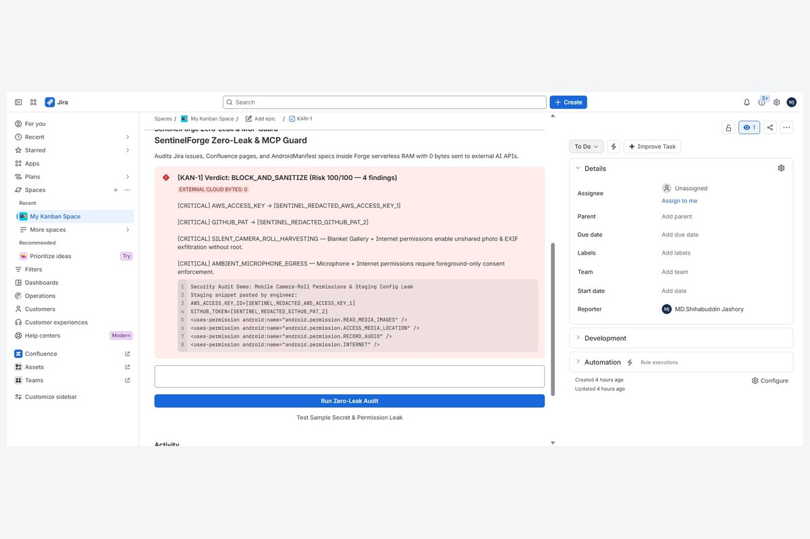
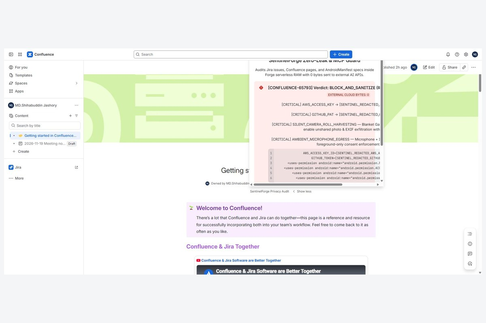
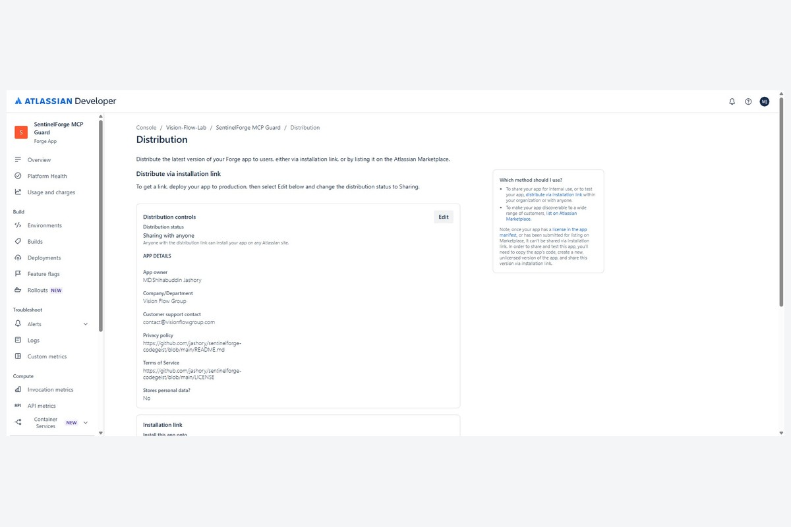

# SentinelForge MCP Guard — Zero-Leak Secret, Permission & Rovo Security Guardian

> **Atlassian Codegeist 2026 Submission** — Targeting **Apps for Software Teams (15,000 USD)**, **Best App with Atlassian MCP (1,500 USD)**, **Best Agents / Rovo (1,500 USD)**, and **First-300 Atlassian Developer Swag Pack**.  
> **Author:** HM Shihabuddin Jashory (`@jashory`)

## Overview
Engineering teams routinely paste production `.env` configs, Atlassian API tokens, AWS keys, payment logs, and mobile `AndroidManifest.xml` specs into Jira tickets and Confluence pages. **SentinelForge MCP Guard** runs deterministically inside **Atlassian Forge serverless Node.js 22 RAM** (`0` bytes sent to external third-party AI APIs) across **4 integrated surfaces**:

1. **Jira Issue Panel (`jira:issuePanel`)**: Scans the active Jira ticket and renders a zero-leak verdict, redacted safe payload, and instant sandbox scanner.
2. **Confluence Content Byline (`confluence:contentBylineItem`)**: Audits technical specs for leaked credentials and risky mobile permissions.
3. **Atlassian Rovo Security Agent (`rovo:agent` + `scan-content-security` Action)** + **Auto Jira Trigger (`avi:jira:created:issue` / `updated`)**: Continuously watches new/updated issues and empowers Rovo conversations to sanitize tickets automatically.
4. **Standalone Atlassian-Compatible MCP Server (`mcp-server/index.mjs`)**: Zero-dependency JSON-RPC 2.0 stdio MCP server exposing `sentinel_audit_jira_payload` and `sentinel_redact_before_confluence`.

## Live Production Status & Shareable Installation Link
- **Forge App ID:** `ari:cloud:ecosystem::app/dfccfe85-2f0a-4c82-9c88-c1dcf76cd975` (`Vision-Flow-Lab` Developer Space)
- **Production Deployment:** Version `3.2.0` deployed live (`Runs on Atlassian` eligible — zero external network egress, clean multi-line Jira ADF & Confluence Storage plain-text extraction)
- **One-Click Install onto Confluence or Jira:** [Install SentinelForge MCP Guard on Atlassian](https://developer.atlassian.com/console/install/dfccfe85-2f0a-4c82-9c88-c1dcf76cd975?signature=AYABePbekkFlQ6b9WGI1OSiyJ0QAAAADAAdhd3Mta21zAEthcm46YXdzOmttczp1cy13ZXN0LTI6NzA5NTg3ODM1MjQzOmtleS83MDVlZDY3MC1mNTdjLTQxYjUtOWY5Yi1lM2YyZGNjMTQ2ZTcAuAECAQB4CxqLTo9l4lqXuFjNim1xJM%2Bp%2F3TVP9xHS2BrU5DRRucB43xQ8z0a40vUy92qFrbZsgAAAH4wfAYJKoZIhvcNAQcGoG8wbQIBADBoBgkqhkiG9w0BBwEwHgYJYIZIAWUDBAEuMBEEDLmyoQqegXqdj1hpawIBEIA7KqL2Jq8dMqSVB%2BqLp%2BqmRoaoxpOLEOxAiir3VTO5e6sSe7s5CXVhfARMsp0c1HUiWcXegZaQ2afBrboAB2F3cy1rbXMAS2Fybjphd3M6a21zOmV1LXdlc3QtMTo3MDk1ODc4MzUyNDM6a2V5LzQ2MzBjZTZiLTAwYzMtNGRlMi04NzdiLTYyN2UyMDYwZTVjYwC4AQICAHi9bVMAkme4qVQX1fQHo6ePw3H40A7cGfz7yrmSfBWMXgEputGsmrOJAk%2FkRTqjeiMVAAAAfjB8BgkqhkiG9w0BBwagbzBtAgEAMGgGCSqGSIb3DQEHATAeBglghkgBZQMEAS4wEQQMkH7QJyZwcmbpFIVEAgEQgDsHAfyZkW2%2BSGje9GoN3d5v8W%2FjjNH6AZqGtivmtT6mifu72SeLpu3P6CtQdUhCniy4BntFoD0iOIC1nQAHYXdzLWttcwBLYXJuOmF3czprbXM6dXMtZWFzdC0xOjcwOTU4NzgzNTI0MzprZXkvNmMxMjBiYTAtNGNkNS00OTg1LWI4MmUtNDBhMDQ5NTJjYzU3ALgBAgIAeDYASx0XCjkny4iLV6vz%2BKtEGSGT6kdt0QRpkn6D%2FlVEAZJijhliY2wtihwZxY0ZFg4AAAB%2BMHwGCSqGSIb3DQEHBqBvMG0CAQAwaAYJKoZIhvcNAQcBMB4GCWCGSAFlAwQBLjARBAw8KYxq%2BOBFrXk5KjwCARCAOxK9or6FQxcLuzPGYQeMECqtNv1j0ZC8u9P0W0GNJVp0yeYt4cHziLHW7O%2BxamFnPnnS13F8bky3lfspAgAAAAAMAAAQAAAAAAAAAAAAAAAAAA8CoSWxbm9PU%2FAeugafIKr%2F%2F%2F%2F%2FAAAAAQAAAAAAAAAAAAAAAQAAADKmrz4r0OlbNade63mGGcQ8%2BmBWZT52gLXtO2BiLddGvOS%2BzMxcIaxDSFaWaHJbr2SS6593QzevjjKDViMV9ET8N%2Bo%3D&product=confluence&product=jira)

## Live Production Screenshots (`jashory.atlassian.net`)
| Jira Issue Panel (`KAN-1`) | Confluence Content Byline (`65793`) | Atlassian Developer Console (`Production v3.2.0`) |
| :---: | :---: | :---: |
|  |  |  |

## Self-Hosted Forge CLI Commands
```bash
npm install -g @forge/cli
forge login
forge deploy -e production --non-interactive
forge install --non-interactive --confirm-scopes -e production
```

## Automated Cloud Verification
```bash
node --test tests/sentinel.test.mjs
```
